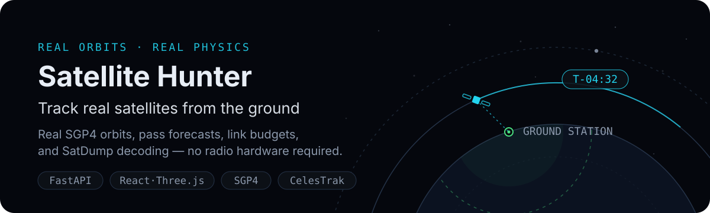
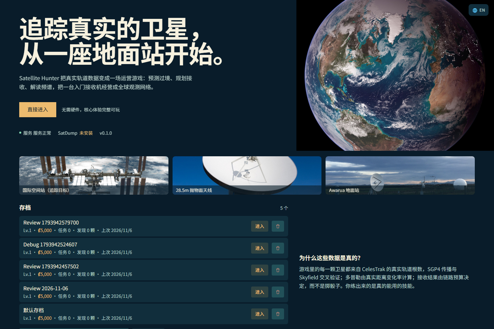
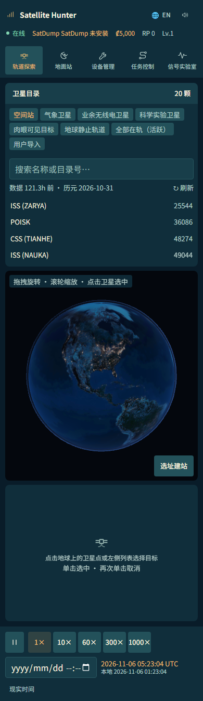

[简体中文](README.md) · **English**

# Satellite Hunter · Ground-station simulator

Build a satellite-observation network: place ground stations, predict passes, track reception and inspect recordings using real orbital propagation.



[](https://github.com/LINYEANSHU/satellite-hunter/actions/workflows/ci.yml)
[](LICENSE)

## In the app



<details>
<summary>Show the mobile layout</summary>



</details>

## Start

Use Python 3.11+ and Node.js 20+ (CI uses Node 22). SatDump is an optional external tool, not a prerequisite for the basic game.

On Windows, double-click or run:

```bat
scripts\dev.bat
```

On Git Bash, Linux or macOS:

```sh
bash scripts/dev.sh
```

The scripts install dependencies and start the backend at `http://localhost:8000` and frontend at `http://localhost:5273`. Open the frontend. Initial setup needs network access to download dependencies.

Create a save → choose a satellite → build a station → buy and install equipment → inspect a pass window and schedule a mission.

## Observation and progression

- **Real orbits, labeled simulation**: CelesTrak GP/TLE data is propagated with SGP4. Reception uses a link-budget model and seeded jitter marked `SIMULATED_RF`; prices, rewards and research are game mechanics.
- **Station networks**: location, elevation mask, antennas, receivers, rotators, missions and research affect results.
- **Pass prediction**: AOS/LOS, peak elevation, azimuth and Doppler help select reception windows.
- **Signal laboratory**: inspect IQ waveforms, spectra, waterfalls and constellation statistics, or send a recording to external SatDump for decoding.
- **Nine pages**: menu, explorer, stations, equipment, missions, signal lab, codex, achievements and settings, with Chinese/English and narrow-screen navigation.

Catalog definitions and owned equipment use their proper data shapes, so equipment loads correctly. Save creation, requests and decoder availability show meaningful status. Shortcuts respect inputs/buttons; `1`–`5` match the five time-speed controls.

## Verify and develop

```sh
# From the repository root, after installing backend dependencies
cd backend
python -m pytest -q
```

```sh
# Another terminal, starting at the repository root
cd frontend
npm ci
npm run test
npm run build
```

The backend suite includes a launcher regression; the existing five frontend tests and production build pass. Browser checks against a real local API cover all nine routes at desktop/phone widths, populated equipment, isolated review saves and time shortcuts.

WebGL verification used CPU SwiftShader without hardware GPU acceleration. Real SDR reception and real SatDump decoding were not tested; adapter tests use mocks. Ordinary browsers choose their own 3D rendering backend.

## Compatibility and limits

The globe requires WebGL. Orbital refresh needs a network connection and can use caches; old TLEs are unsuitable for precise prediction. The RF model is a game approximation, not measured link engineering. Decoding recordings requires a separate SatDump installation. Full focus management in legacy dialogs and physical touch gestures still need further work.

Runtime data lives in `backend/data/` and is excluded from source commits. The main MIT license does not replace licenses for external programs, data or images.

## Documentation and license

[Gameplay](docs/gameplay.md) · [Architecture](docs/architecture.md) · [API](docs/api.md) · [Orbit data](docs/orbit-data.md) · [SatDump](docs/satdump.md) · [Known limits](docs/known-issues.md)

Code is [MIT](LICENSE). External SatDump retains GPL-3.0. SGP4, CelesTrak, NASA/Wikimedia imagery and other source attribution remain in [licenses and assets](docs/licenses.md) and the in-app image credits.

## Contributors

- [LINYEANSHU](https://github.com/LINYEANSHU)
