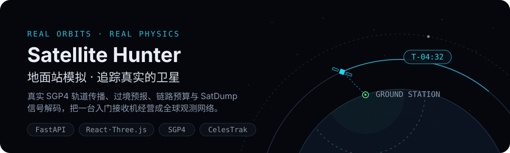
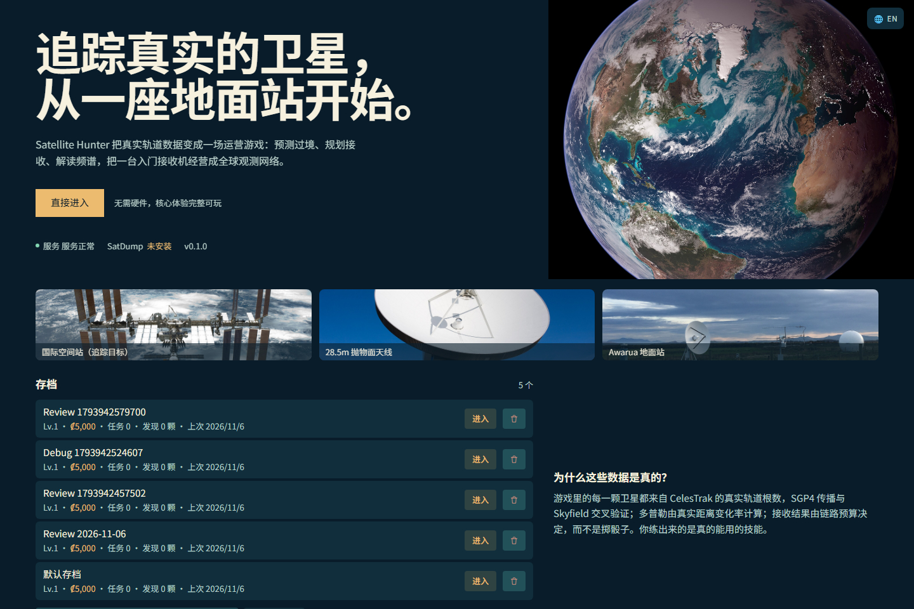
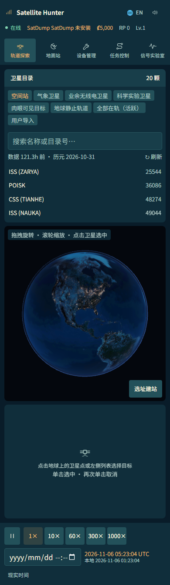

**简体中文** · [English](README.en.md)

# Satellite Hunter · 地面站模拟

从选址建站到预测过境、追踪接收和分析录波：用真实轨道传播搭建自己的卫星观测网络。



[](https://github.com/LINYEANSHU/satellite-hunter/actions/workflows/ci.yml)
[](LICENSE)

## 实际界面



<details>
<summary>展开手机界面</summary>



</details>

## 快速开始

需要 Python 3.11+、Node.js 20+（CI 使用 Node 22）。SatDump 为可选外部程序，不是基础游玩的前置条件。

Windows 双击或在命令行运行：

```bat
scripts\dev.bat
```

Git Bash / Linux / macOS：

```sh
bash scripts/dev.sh
```

启动脚本安装依赖并启动后端 `http://localhost:8000`、前端 `http://localhost:5273`；浏览器打开后者。首次启动需要可用的依赖下载网络。

创建存档 → 在探索页选择卫星 → 建立地面站 → 购买并安装设备 → 查看过境窗口并安排任务。

## 观测与经营

- **真实轨道，明确区分模拟**：CelesTrak GP/TLE 数据由 SGP4 传播；接收模型使用标为 `SIMULATED_RF` 的链路预算与种子化抖动。价格、奖励和研究属于游戏机制。
- **地面站网络**：选址、最小仰角、天线/接收机/转台设备、任务和研究相互影响。
- **过境预报**：AOS/LOS、最高仰角、方位与多普勒帮助选择接收窗口。
- **信号实验室**：检查 IQ 波形、频谱、瀑布图和星座统计；可把录波交给外部 SatDump 解码。
- **九个页面**：主菜单、探索、地面站、设备、任务、信号实验室、百科、成就和设置；提供中英文与窄屏导航。

设备目录和库存设备使用各自的数据结构，设备页可正常加载；创建存档、请求和解码能力状态都有反馈。快捷键尊重输入框与按钮，数字 `1`–`5` 对应时间栏五档速度。

## 验证与开发

```sh
# 从项目根目录执行；先安装对应目录依赖
cd backend
python -m pytest -q
```

```sh
# 另开终端，从项目根目录执行
cd frontend
npm ci
npm run test
npm run build
```

后端套件包含启动入口回归，前端现有 5 项测试通过，前端生产构建成功。真实本地 API 的浏览器检查覆盖九条路由的桌面/手机布局、设备目录、独立评审存档和时间快捷键。

WebGL 浏览器验证使用 CPU SwiftShader，没有启用硬件 GPU；没有测试真实 SDR 收信或真实 SatDump 解码，后端适配测试使用 mock。正常浏览器的 3D 渲染后端由浏览器决定。

## 兼容与边界

3D 地球需要 WebGL。轨道数据更新依赖网络，可使用缓存；TLE 有时效，旧根数不适合高精度预报。RF 模型是游戏近似，不能替代实测链路设计。实际录波解码需要单独安装 SatDump；历史模态框的完整焦点管理和实体触屏手势仍有完善空间。

运行数据位于 `backend/data/`，不随代码提交。主项目 MIT 许可不改变外部程序、数据和图像的原有许可。

## 文档与许可

[玩法](docs/gameplay.md) · [架构](docs/architecture.md) · [API](docs/api.md) · [轨道数据](docs/orbit-data.md) · [SatDump](docs/satdump.md) · [已知边界](docs/known-issues.md)

代码使用 [MIT](LICENSE)。SatDump 以独立进程集成并保留 GPL-3.0；SGP4、CelesTrak、NASA/Wikimedia 图像及其他来源的归属见 [许可与素材说明](docs/licenses.md) 及页面图像署名。

## 贡献者

- [LINYEANSHU](https://github.com/LINYEANSHU)
